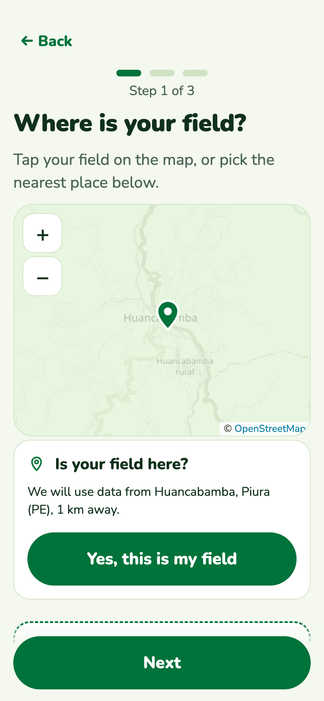
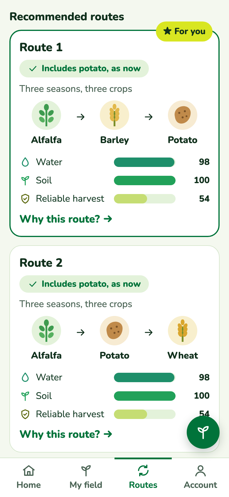
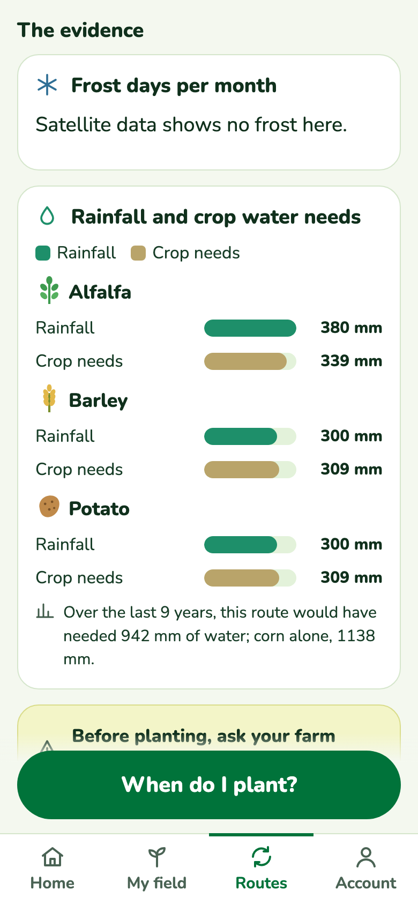

# TerraPath

**A GPS for crop rotation, powered by NASA Earth data.**

NASA Space Apps Challenge 2026 · Piura, Peru · Challenge: *Field Shift: Adapting Farms with NASA Data*

**Try the app:** https://al3xi3w.github.io/terra_path_nasa/ (works on a phone, and offline after the first visit)

---

## What TerraPath does

A farmer taps a plot on a map and answers two short questions: what grows there today, and what matters most to them (saving water, protecting the soil or a reliable harvest). TerraPath then proposes **three crop-rotation routes for the next three seasons**. Each route is scored from 0 to 100 on water, soil and reliable harvest, and every score comes with its reasons in plain language.

| Tap your plot | Compare three routes | Why this route? |
|:---:|:---:|:---:|
|  |  |  |
| Map, nearest site with data and its altitude | Water, soil and reliable-harvest scores | Frost by month, rainfall against crop needs |

*Screens from the working app, with real data for Huancabamba, Piura (−5.24, −79.45).*

## Why it matters

Farmers plan with yesterday's climate. Frost, late rains and El Niño years move the planting window from one season to the next, yet many smallholders repeat the same crop out of habit, wearing out soil and water. Satellite data is free, but it arrives as rasters and technical terms, not as a decision in the farmer's own language.

TerraPath's answer to the challenge is to **change the rotation, not just the sowing date**. It answers the question every farmer asks before sowing: *"What should I plant next, so my field still feeds me in three seasons?"*

## How it works

The engine turns NASA and FAO data into routes in five steps:

1. **Locate the plot.** Altitude and slope come from NASA SRTM at 30 m. If the plot sits in rugged mountains, the app warns that the climate grid may not match the field.
2. **Read the climate.** NASA POWER provides 44 years (1981–2024) of daily rain, frost and heat, plus the inputs for FAO-56 reference evapotranspiration (ET₀).
3. **Build every rotation.** A 16-crop library is filtered by FAO EcoCrop climate and altitude limits; the engine then lists every three-season sequence that passes (204 in Huancabamba).
4. **Score each rotation from 0 to 100.**
   - *Water:* crop demand (FAO-56 Kc × ET₀) against rainfall.
   - *Soil:* legumes, changes of botanical family between seasons, cover crops.
   - *Reliable harvest:* frost below each crop's lethal temperature, rainfall variability and dry years.
5. **Pick three routes.** The engine keeps the Pareto front and shows the best route for the farmer's priority, compared with what they grow today.

**Honest by design.** Every number can be traced to its source file and SHA-256 hash. A missing input is shown as "—" and reported as unknown; it is never treated as zero or as favourable.

## Data

| Source | What we use it for | Status |
|---|---|---|
| NASA POWER (daily) | Rain, frost, temperature, ET₀ inputs | Used · 6 sites · 1981–2024 |
| NASA SRTM 30 m | Plot altitude and slope, mountain warning | Used · 5 tiles · all 6 sites |
| FAO-56 Kc · FAO EcoCrop | Crop water demand, frost and climate limits | Used · 16-crop library |
| FAOSTAT | Typical monoculture for the backtest | Used · baseline only |
| GPM IMERG V07 (monthly) | Rainfall 2001–2025 at every site | Context · not in scores yet |
| FAO GAEZ | Suitability layers | Context · legend unverified |
| SMAP · MODIS | Soil moisture, vegetation | Not used · files were empty |
| Sentinel-2 NDVI | Vegetation greenness | Not used · 0 of 403 values pass quality checks |

The six sites are Huancabamba, Piura sur and Piura norte (Peru), central Iowa (US), Nakuru (Kenya) and California's Central Valley (US). The data itself is not stored in this repository (about 1.3 GB, from third parties); **[DATA.md](DATA.md)** explains where each file comes from and how to download and regenerate it.

## Results

Routes were chosen with 1981–2015 data only and then replayed on 2016–2024 (nine years). The baseline was maize grown every year, the crop with the largest harvested area in each country according to FAOSTAT.

| Site | Route | Maize every year | Difference |
|---|---:|---:|---:|
| Huancabamba, Piura (PE) | 942 mm | 1,138 mm | −17% |
| Piura sur (PE) | 1,691 mm | 1,808 mm | −6% |
| Iowa central (US) | 1,494 mm | 1,870 mm | −20% |
| Nakuru (KE) | 1,208 mm | 1,773 mm | −32% |

*Total water deficit 2016–2024, max(0, Kc × ET₀ − rain).* At all four sites that produce routes, the route needed less water than maize. The routes do not change when the weight on water moves from 20% to 80%. Details: [reports/backtesting.md](reports/backtesting.md) and [reports/sensibilidad_pesos.md](reports/sensibilidad_pesos.md).

## Limits we state openly

- **Same top route at four sites.** Alfalfa › barley › potato wins in Piura, Iowa and Kenya alike: the 16-crop library and a single sowing window cannot yet tell those climates apart. Quinoa and local varieties are not in the library.
- **Two rainfall sources disagree in Piura.** GPM IMERG gives about twice NASA POWER's annual rain (834 vs 467 mm in Huancabamba). Scores use POWER until station data settles which is right.
- **Two sites without routes.** In Piura norte, SRTM places the plot at 2,864 m but the climate grid at 878 m, so no rotation passes. In California, water demand is unknown for the eligible crops.
- **Gaps in crop data.** Eight of the 16 crops lack a verified FAO-56 Kc and six lack a lethal frost temperature; those scores show as unknown.
- **Not field-validated.** There are no plot-level yield, soil or irrigation records. TerraPath screens options; an agronomist confirms them.
- **Six sites only.** A plot more than 30 km from a site gets "no data for this area yet" rather than a borrowed answer.

## The app

A web app that installs on a phone (Android and iPhone) and works without internet after the first visit. It has no server: the account and the farmer's answers stay on the phone, and the 4-digit PIN is stored only as a salted SHA-256 hash.

- **Onboarding in three steps:** where the field is (map, GPS or list of sites), what grows there now, and what matters most.
- **Routes:** up to three routes with score bars, the farmer's current rotation for comparison, and a side-by-side chart of all routes.
- **Why this route?:** reasons in plain language, frost days per month, rainfall against crop needs, and the 2016–2024 comparison with maize.
- **When to plant:** sowing and harvest month for each season, typical first frost, and a downloadable calendar reminder (.ics).
- **Home and My field:** the crop growing now, this week's tasks, a normal-year view by week, month (daily rainfall calendar) and year (the three seasons in sequence). All climate is labelled "typical conditions, not a forecast", with a reminder to check with a farm adviser.
- **Languages:** English and Spanish are complete. Portuguese, French, Kiswahili, Hindi, Chinese and Arabic (right to left) are machine-drafted, and the app says so on screen. Quechua and Aymara are shown in English until native speakers of the local variety write them.
- **Assistant button:** a placeholder for a future feature; today it only shows "Coming soon".

The design follows the team's Figma prototype ([prototipo/](prototipo/)). Map tiles come from OpenStreetMap through Leaflet, with no Google services.

## Run it locally

Requires Python 3 (developed with 3.14) and, for the app tests, Node.js.

```bash
python3 -m venv .venv
.venv/bin/python -m pip install -r requirements.txt

# 1. Download and regenerate the data (order and credentials in DATA.md)
# 2. Export the engine results for the app
.venv/bin/python scripts/build_app.py

# 3. Open the app at http://localhost:8000
.venv/bin/python -m http.server 8000 -d app

# 4. Run the tests
.venv/bin/python -m pytest -q
```

The test suite currently reports **195 passed and 3 skipped** (the skipped tests need the SMAP, MODIS and half-hourly IMERG files, which came back empty).

The published app is the `app/` folder served from the `gh-pages` branch through GitHub Pages. To publish a new version, run `scripts/build_app.py` and copy `app/` (including `app/data/`) to that branch.

Direct links to a screen are useful for demos, for example:
`https://al3xi3w.github.io/terra_path_nasa/#user=Ana&view=routes&pilot=piura_1&care=water&now=potato`
(see [app/README.md](app/README.md) for all options).

## Repository structure

| Folder | Contents |
|---|---|
| `src/` | The engine: climate profiles, crop library, terrain, water requirement, scores, routes, backtest, app export |
| `scripts/` | Command-line entry points for each step (download, profiles, routes, backtest, sensitivity, app build) |
| `app/` | The farmer web app (HTML, CSS, JavaScript, service worker, translations) |
| `config/` | Pilot sites, data sources and verified FAO-56 tables |
| `notebooks/` | `terrapath_recorrido.ipynb`, a step-by-step walkthrough of the real engine with its outputs |
| `reports/` | Data audit, backtest, sensitivity, figures and earlier project notes |
| `tests/` | Python and JavaScript tests |
| `prototipo/` | Figma screens the app is built from |
| `docs/screenshots/` | Screenshots used in this README |

## Next steps

1. Settle the POWER and IMERG rainfall difference in Piura with SENAMHI weather stations.
2. Add Andean crops (quinoa, local potatoes) with verified Kc values and frost limits.
3. Have an agronomist review the rules and local planting calendars.
4. Languages written by native speakers, a listen button, and more districts.

## Team

 Mia Wood · María Fernanda Lazón · Mauricio Terán · Mia Hurtado

## Acknowledgements and licences

- Data from NASA POWER, NASA SRTM (LP DAAC), NASA GPM IMERG (GES DISC), FAO (FAO-56, EcoCrop, FAOSTAT, GAEZ, Crop Calendar), ESA Copernicus Sentinel-2 and USDA NASS, each under its own terms of use.
- [Leaflet](https://leafletjs.com) (BSD-2), map data © [OpenStreetMap](https://www.openstreetmap.org/copyright) contributors (ODbL), [Nunito](https://github.com/googlefonts/nunito) font (SIL Open Font License).
- We used Claude (Anthropic) as a coding and writing assistant. The routes the farmer sees come from transparent, rule-based scoring, not from a machine-learning model; the team reviewed all content.

Notes from the earlier data-audit stage of the project are kept in [reports/README_etapa_anterior.md](reports/README_etapa_anterior.md).
